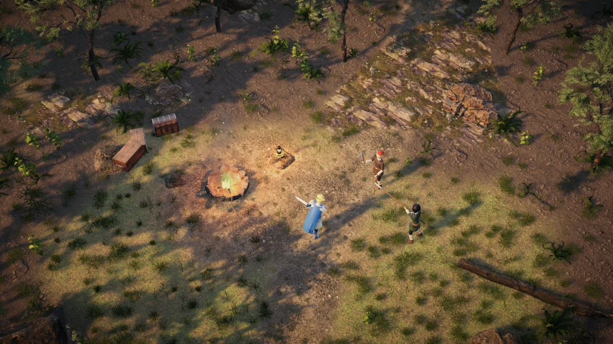
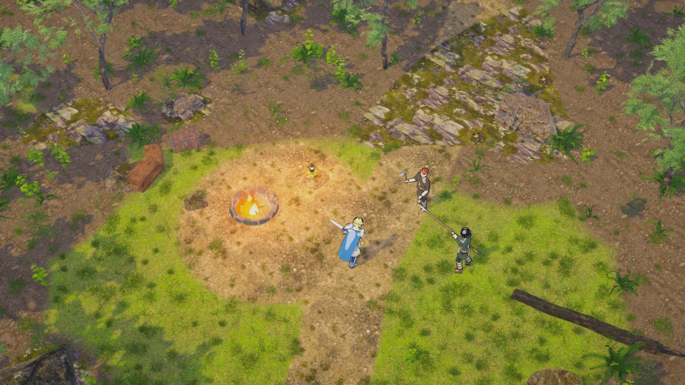
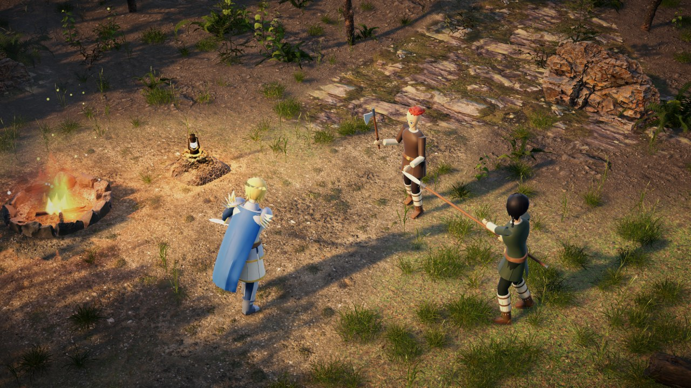
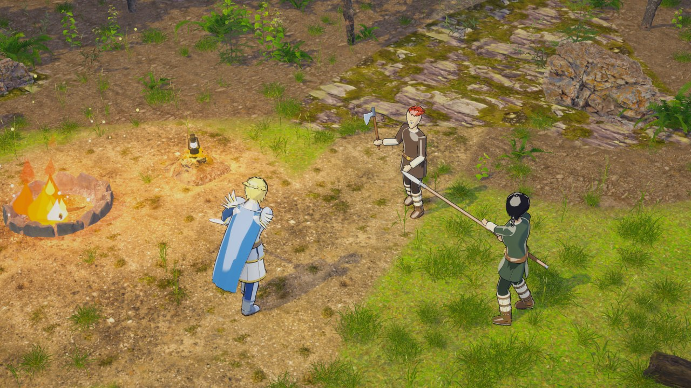

# Art Direction Samples — Modern or Anime

Two candidate looks for the final game, rendered from the game camera in Unity with real scanned assets instead of
code-built shapes. Both show the same forest camp: a fire pit, gear, a lantern on a stump, the hero and two outlaws.
Only the shading, lighting and grading differ.

| | Modern (Lost Ark / Diablo IV direction) | Stylized anime (Genshin direction) |
|---|---|---|
| Game camera |  |  |
| Close |  |  |

## How each is made

**Modern**
- Physically based shading: URP Lit with the scans' color and normal maps.
- A height-blended Unity Terrain: grass, forest floor, trodden path and stone, with mask maps built from each layer's
  brightness and roughness.
- `Runeheir/LitFoliage` (new): two-sided PBR leaves and grass. It flips back-face normals, which URP Lit doesn't do, and
  uses sphere normals so a canopy or clump shades as one volume. It also adds light through backlit leaves.
- Golden-hour sun with long soft shadows, and ambient light taken from an HDRI sky.
- Post: ACES tonemapping, a warm/cool split grade, stronger SSAO and a vignette.
- Fire: layered particles (teardrop flame tongues, an inner flame, a glow, smoke, embers) lit by a warm point light.

**Stylized anime**
- The same scans cel-shaded:
  - `Runeheir/ToonFoliage` (new) puts the Runeheir/Toon light band on textured, alpha-clipped surfaces, with sphere
    normals, a darker base, translucency and a saturation control.
  - `Runeheir/ToonSplat` (new) paints the terrain. It blends the layers by brightness with crisp edges, softens the
    photo detail toward paint with a mip bias, and tints and saturates each layer.
- A bright day sun, a neutral tonemap, more bloom and saturation, and blue-violet shadows.
- Hero and enemies keep the toon shader and ink outlines.
- Fire: crisp-edged cartoon flame tongues, solid color, a pale inner flame.

## Reproduce

1. Fetch the assets (about 250 MB, all **CC0** from [Poly Haven](https://polyhaven.com), git-ignored):

   ```
   python Tools/ArtSamples/fetch_polyhaven.py
   ```

   The script downloads into `Assets/_Runeheir/ThirdParty/PolyHaven/`:
   - 15 models: tree, fir saplings, shrubs, ferns, grass clumps, moss, rocks, boulder, dead trunk, stump, fire pit,
     crate, lantern and chest.
   - 4 ground textures.
   - 1 HDRI sky.
2. Run **Runeheir ▸ Art ▸ Render Style Samples**, or from the command line:

   ```
   Unity -batchmode -projectPath . -executeMethod Runeheir.EditorTools.ArtSamples.RenderFromCommandLine
   ```

   It writes `Builds/Previews/sample_modern.png`, `sample_modern_close.png`, `sample_anime.png` and
   `sample_anime_close.png`. The first run imports the assets and takes a few minutes. Generated cutout textures and
   terrain masks go to `ThirdParty/PolyHaven/Generated/`.

The builder is `Scripts/Editor/ArtSamples.cs`. It makes a new scene for each style and never touches the game's maps or
the project's render settings: the SSAO boost is put back after each shot.

## What either direction still needs

The samples are honest about the gaps. The environment reaches the target look; the characters do not yet.

- **Characters.** The hero and outlaws are the current Blender-built body: flat colors, simple faces, no texture
  detail. They read fine in the anime sample and look like toys in the modern one.
  - Anime: a VRoid Studio or commissioned anime model per job line would close the gap, with textured outfits, faces
    and hair cards on the existing rig.
  - Modern: this needs fully textured, realistically proportioned characters (purchased packs or commissioned), a much
    larger job with 40 jobs × 2 bodies.
- **Monsters and MVPs.** Most are still primitive placeholders, so both directions need modeled, rigged and animated
  monsters. The wolves were left out of the samples for that reason.
- **Performance.** The scanned tree is about 2 million triangles and the grass is thousands of separate objects, which is fine
  for a still but not for a game. Shipping either look means game-ready foliage: LODs and impostors, instanced grass
  through `GrassField`, and a vegetation budget per map.
- **The world kit.** Buildings, walls, banners, dungeon pieces and Norse props need the same treatment as the camp
  props. Today they're the code-built kit from [Art Pass 3](Art_Environment.md). CC0 sources such as Poly Haven, KayKit
  and Quaternius cover some of it; Norse-specific pieces need modeling.
- **Licensing.** Poly Haven assets are CC0, so they're free for commercial use with no attribution. Anything bought or
  commissioned later needs its own license check.

**Trade-off.** The anime direction fits the existing characters, the XileRO/Ragnarok heritage and the toon pipeline
already in the game, and stylized assets are cheaper to make consistent. The modern direction looks richer in the
environment, but it needs realistic characters to match, the biggest and costliest asset gap.
