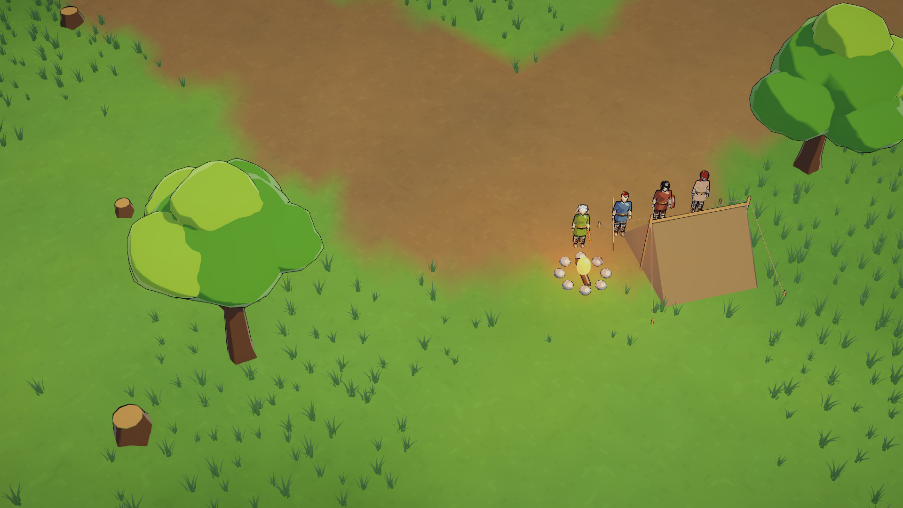
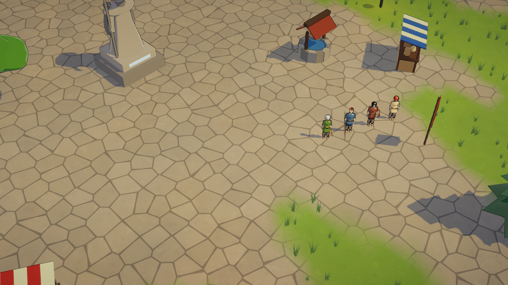
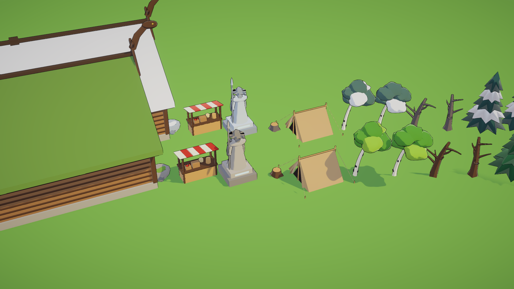

# Art Pass 3: the Environment

The maps were flat colored squares with primitive props (a ball on a stick for a tree). This pass gives them soft
painted ground, grass that sways, a modeled scenery kit and a finished look after rendering. Like the characters,
everything is generated by code, so it rebuilds identically.



*Whisperwood Plains at the game camera: blended ground with a worn path, grass tufts, broadleaf trees, stumps and the
camp's tent.*



*Vigrid Haven's plaza: flagstones, the well, a market stall and the statue of the Wanderer.*



*The kit in the game shader, painted for the meadow (front) and the tundra (back): longhouse and mead hall, stalls,
the statue, stumps, tents, birches, dead trees, broadleafs and firs.*

## 1. What changed in the game

- **Ground.** One fine mesh per map (about a meter between vertices), not a quad per 4 m cell:
  - The ground kinds (grass, path, paving, snow, ice) blend at every vertex. Noise makes their edges wander like worn
    grass, so there are no stair steps.
  - `Runeheir/Terrain` adds broad light and dark patches, fine grain and painterly flecks, all in world space.
  - Paved ground gets irregular flagstones with dark grooves.
- **Grass.** Tufts grow on open grass (thick in some patches, thin in others) and never on paths, paving or snow, or
  inside a rock or trunk.
  - They're drawn GPU-instanced in 16 m chunks near the camera, and sway in the wind.
  - They take the ground's colors and light, so they blend into the meadow.
  - Meadows and jungles are thickest; birch woods and fjords thinner; towns and coasts sparse; snow, sand and ash none.
- **The scenery kit** (`Resources/Environment`, built by `Tools/Blender/build_environment.py`):

  | Models | Look |
  |---|---|
  | `tree_round_0-2` | Broadleafs: a crown of chunky blobs, the upper ones lighter, on a flared trunk with branches |
  | `tree_pine_0-1` | Firs: four or five star-edged tiers; the light tiers turn to snow on cold maps |
  | `tree_birch_0-1` | Slender white birches with dark marks and an airy crown (gold and russet in the birch woods) |
  | `tree_dead_0-1` | Bare, crooked trees for crypts, the tundra and haunted ground |
  | `bush_0-1`, `fern_0`, `flowers_0`, `stump_0` | Undergrowth |
  | `rock_0-2` | Faceted boulders, some with a cap of moss (or snow) |
  | `tent_0` | An A-frame camp tent with poles, guy ropes and a dark doorway |
  | `house_0-1`, `meadhall_0` | Norse longhouses with log walls, turf, thatch or shingle roofs, crossed gable boards and a warm window; the mead hall adds dragon heads, shields and double doors |
  | `stall_0`, `well_0`, `statue_0` | A striped market stall with goods, a stone well, and the Wanderer with spear and ravens |

  The models carry only slot names (Bark, Leaf, Needle, Rock, Moss, Roof...). `EnvironmentKit` paints them per map
  theme, so one fir is dark green on the fjord and snow-laden on the tundra. Scenery uses a matte toon material (no
  glossy highlight, which made the old trees look like plastic balls).
- **Undergrowth.** Fields now scatter bushes, stumps, ferns and wildflowers between the trees. Flowers and ferns can be
  walked through.
- **Post-processing,** built in code so the project's own pipeline assets are untouched:
  - a neutral tonemap and a soft bloom (stronger in dark dungeons, where torches and runes carry the light);
  - a little contrast and saturation, highlights tinted with the map's sunlight, and a light vignette;
  - SMAA anti-aliasing.
- **Fixes along the way.**
  - Vertex colors are converted to linear space; the project renders in linear, so the ground had come out washed out.
  - Materials with no ink outline now switch the outline pass off. At zero width it still painted back faces black,
    which showed through thin sheets.
  - The terrain material and kit models reload after a scene change unloads them.

If the kit or the shaders are missing (an older GPU, a project without them), the maps fall back to the old flat ground
and primitive props.

## 2. The pipeline

```
"C:/Program Files/Blender Foundation/Blender 5.2/blender.exe" -b --factory-startup -P Tools/Blender/build_environment.py
... -- --only tree_round_0,rock_1 --no-render
```

- It writes `Assets/_Runeheir/Resources/Environment/<model>.fbx`; `EnvironmentModelPostprocessor` imports them as
  static meshes in meters with their own normals.
- A new model needs three things:
  1. a function that returns its parts (`blob`, `tube`, `box`, `hexa`, `gable_roof`, `cone_layer`);
  2. its entry in `MODELS`;
  3. any new slot's colors in `EnvironmentKit.ColorOf`.
- Faces must wind counter-clockwise seen from outside. A sheet seen from both sides gets two skins a centimeter apart,
  wound opposite ways.
- **Runeheir ▸ Art ▸ Render Map Previews** draws every theme from the game camera and from above. It also draws the
  bestiary and the kit lineup (`Builds/Previews/environment_kit.png`).

| File | Role |
|---|---|
| `Resources/RuneheirTerrain.shader` | The ground: vertex-colored kinds, patches, grain, flecks, flagstones, toon light |
| `Resources/RuneheirGrass.shader` | Instanced grass: wind sway, the ground's patches and light |
| `Runtime/World/WorldBuilder.cs` | Builds the blended ground mesh, then plants the grass |
| `Runtime/World/GrassField.cs` | Plants and draws the grass chunks |
| `Runtime/World/EnvironmentKit.cs` | Loads the kit and paints it per theme |
| `Runtime/Visuals/PostEffects.cs` | The post-processing volume |

## 3. Still to come

- Modeled versions of the remaining primitive scenery: the windmill, forge hut, guild hall, palisades, banners, torches
  and the dungeon props (crypt coffins, ice spikes, lava pools, pillars).
- Water with movement, cliffs and height in the ground.
- Skill and hit effects, and painted portraits and UI frames.
